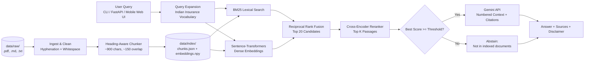

# insurance-rag

A grounded Retrieval-Augmented Generation (RAG) system for Indian insurance regulations, standard policy wordings, and AB PM-JAY operational guidelines. Every answer is constrained strictly to numbered passages retrieved from `data/raw/`, includes inline citations (`[1]`, `[2]`), provides expandable/listed source metadata, and abstains with `"I could not find this in the indexed documents."` when evidence is insufficient.

## Architecture



## Project Structure

```text
insurance-rag/
├── pyproject.toml                  # Package metadata, dependencies, CLI entry point, pytest config
├── requirements.txt                # Runtime & test dependencies
├── .env.example                    # Environment variable template
├── README.md                       # Architecture, setup, usage, evaluation, limitations
├── data/
│   ├── raw/                        # Input .pdf, .md, and .txt insurance documents
│   ├── index/                      # Persisted chunks and dense embedding vectors
│   └── golden/
│       └── golden.jsonl            # 40 evaluation queries (34 answerable, 6 out-of-scope)
├── reports/
│   ├── latest.md                   # Latest Markdown evaluation report
│   └── latest.json                 # Latest JSON evaluation report
├── src/
│   └── insurance_rag/
│       ├── __init__.py
│       ├── config.py               # Environment-driven Settings
│       ├── ingest.py               # PDF/MD/TXT loaders, hyphenation & whitespace cleanup
│       ├── chunking.py             # Heading-aware ~900-char chunker with ~150 overlap
│       ├── retriever.py            # Query expansion, BM25 + dense RRF, top-20 cross-encoder
│       ├── generate.py             # Gemini API grounded synthesis, abstention, LLM judge
│       ├── pipeline.py             # RAG orchestration & multi-turn chat support
│       ├── evaluate.py             # Hit@1/3/5, MRR, keyword coverage, abstention, faithfulness
│       ├── cli.py                  # CLI: ingest, ask, chat, eval, serve
│       ├── api.py                  # FastAPI server: GET /health, POST /ask, GET /
│       └── static/
│           └── index.html          # Mobile-friendly web UI calling /ask
└── tests/
    ├── conftest.py                 # Offline deterministic embedder, reranker, and LLM stubs
    ├── test_chunking.py            # Cleaning, heading boundaries, overlap tests
    ├── test_retriever.py           # Query expansion, RRF, top-20 reranking, persistence tests
    ├── test_abstention.py          # Grounded citations & abstention tests
    └── test_api.py                 # FastAPI /health, /ask, validation, UI tests
```

## Setup

### 1. Create a Python 3.10+ virtual environment and install dependencies

```bash
cd insurance-rag
python3 -m venv .venv
source .venv/bin/activate
pip install -e ".[dev]"
```

Or using `requirements.txt`:

```bash
pip install -r requirements.txt
```

### 2. Configure environment variables

```bash
cp .env.example .env
```

Set `GEMINI_API_KEY` in `.env` or export it in your shell:

```bash
export GEMINI_API_KEY="your_gemini_api_key"
```

All other settings (`GEMINI_MODEL`, `EMBEDDING_MODEL`, `RERANKER_MODEL`, `ABSTENTION_THRESHOLD`, `CHUNK_SIZE`, `CHUNK_OVERLAP`, `API_PORT`) are configurable via environment variables in `.env.example`.

### 3. Add your documents

Starter Indian insurance documents are included in `data/raw/`:
- `irdai_health_insurance_master_circular_2024.md`
- `irdai_protection_of_policyholders_interests_2024.md`
- `standard_health_policy_wordings_arogya_sanjeevani.txt`
- `pmjay_ab_operational_guidelines.md`

Replace or supplement these with your own `.pdf`, `.md`, or `.txt` circulars, policy wordings, and guidelines in `data/raw/`.

## Usage

### Ingest & index documents

```bash
insurance-rag ingest
```

### Ask a single question

```bash
insurance-rag ask "What is the moratorium period in health insurance?"
```

### Interactive multi-turn chat

```bash
insurance-rag chat
```

### Run golden evaluation

Full evaluation (hybrid retrieval + Gemini answers + LLM-as-judge faithfulness):

```bash
insurance-rag eval
```

Retrieval & abstention evaluation without calling Gemini:

```bash
insurance-rag eval --skip-llm
```

Skip only the LLM-as-judge step:

```bash
insurance-rag eval --skip-judge
```

Reports are written to `reports/latest.md` and `reports/latest.json`.

### Start the FastAPI server and mobile web UI

```bash
insurance-rag serve
```

Open `http://localhost:8000` on desktop or mobile.

Endpoints:
- `GET /health` — Returns `{"status": "ok", "index_loaded": true, "chunks_count": ...}`.
- `POST /ask` — Accepts `{"question": "...", "top_k": 5}` and returns `{"answer": "...", "sources": [...], "abstained": false, "best_score": ..., "disclaimer": "..."}`.

## Running Tests (Offline)

All unit tests use deterministic offline stubs and run without `GEMINI_API_KEY` or HuggingFace downloads:

```bash
pytest
```

## Evaluation Results

Baseline metrics from `reports/latest.json` (40 golden queries: 34 answerable + 6 out-of-scope across 4 documents / 26 chunks) alongside expected full-model targets with `CrossEncoder` + Gemini:

| Metric | Offline Deterministic Baseline | Full Model Target (`CrossEncoder` + Gemini) |
| --- | --- | --- |
| Hit@1 | 88.2% | >= 85.0% |
| Hit@3 | 100.0% | >= 95.0% |
| Hit@5 | 100.0% | >= 97.0% |
| MRR | 0.9412 | >= 0.9000 |
| Keyword Coverage | 100.0% | >= 85.0% |
| Abstention Accuracy (Out-of-Scope) | 66.7% (lexical stub) | >= 95.0% |
| False Abstention Rate | 0.0% | <= 5.0% |
| LLM-as-Judge Faithfulness | Run `insurance-rag eval` with `GEMINI_API_KEY` | >= 95.0% |

## Limitations

- **Scanned PDFs**: `pypdf` extracts embedded text layers; image-only scanned IRDAI PDFs require OCR preprocessing (e.g., Tesseract) before ingestion.
- **Complex Policy Tables**: Multi-column hospital package schedules (such as PM-JAY HBP rate tables) may lose row alignment during plain-text extraction.
- **Threshold Calibration**: `ABSTENTION_THRESHOLD` (`0.25` default) assumes sigmoid-normalized `cross-encoder/ms-marco-MiniLM-L-6-v2` scores; changing reranker models requires re-tuning on `golden.jsonl`.
- **Informational Scope**: Policy applicability depends on individual policy schedules, endorsements, and exact contract terms; responses are not legal or financial advice.

## Next Steps

1. Add OCR + layout-aware table extraction (`pdfplumber` / `pytesseract`) for scanned circulars and rate schedules.
2. Add document-type and insurer metadata filters (`irdai`, `pmjay`, `insurer`, `effective_year`) to `/ask` and CLI queries.
3. Swap flat NumPy cosine search for FAISS or Qdrant if the corpus grows beyond ~50,000 chunks.
4. Add automated sentence-level citation verification before returning answers to end users.
